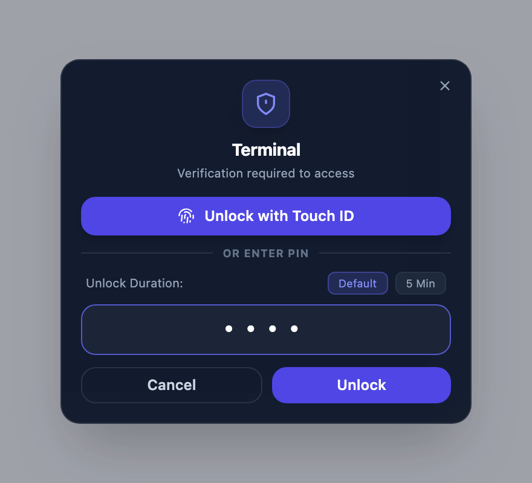
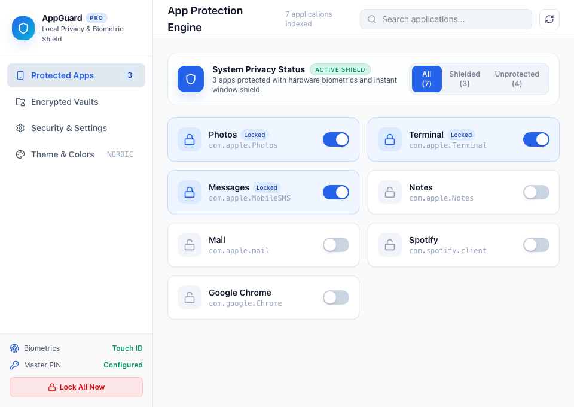
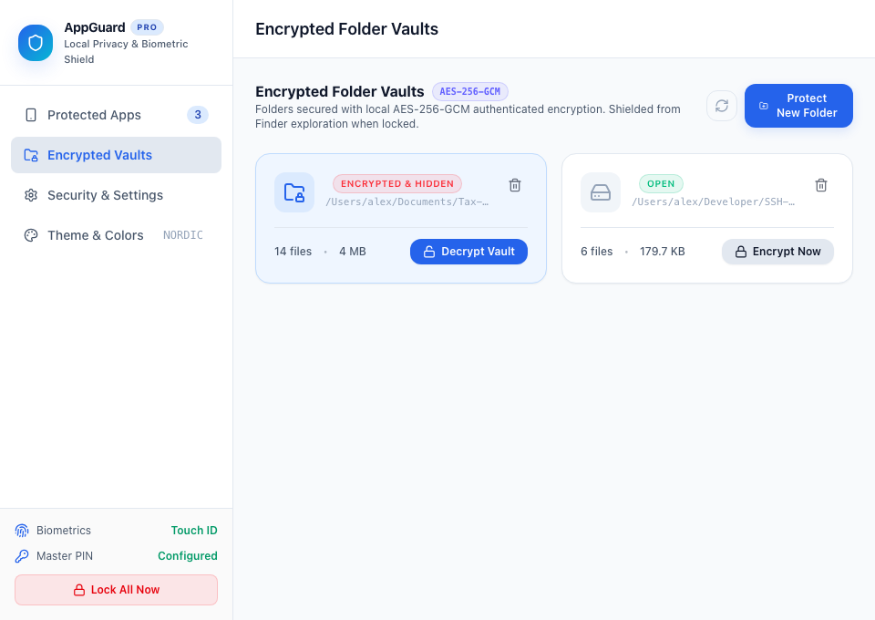
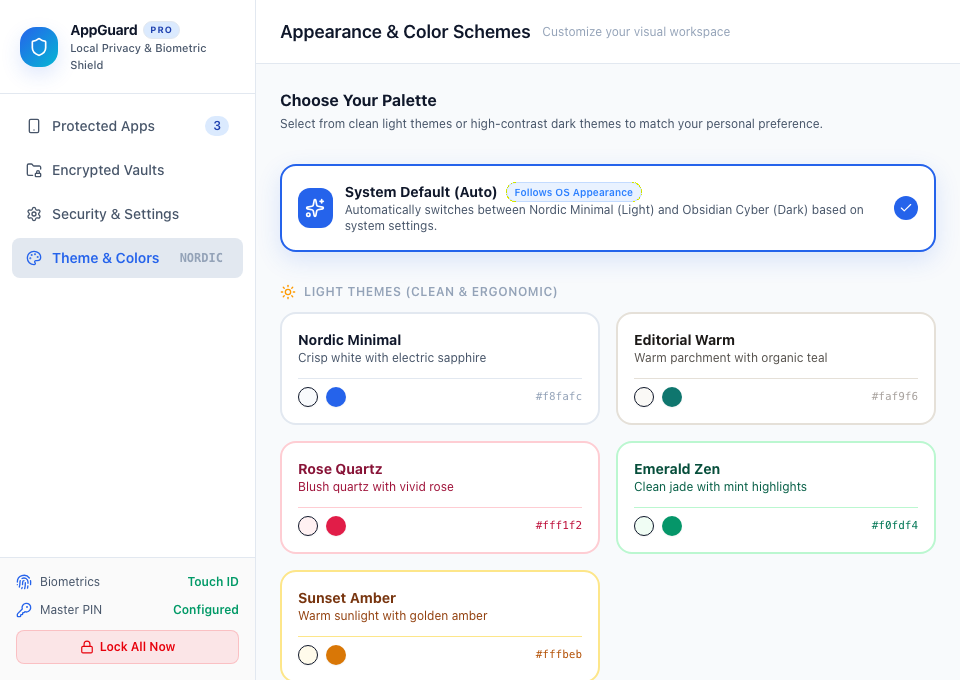
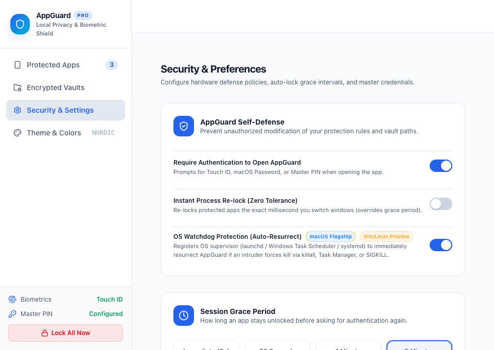

# AppGuard

> **Desktop window shielding and an encrypted file vault, built with Tauri, React, and Rust.**

[](https://github.com/novitaswebworks/appguard/releases)
[](LICENSE)
[](#platform-support)
[](#architecture)
[](#-security-architecture)

AppGuard monitors desktop application window switches and unauthorized access attempts, prompting for macOS authentication or the Master PIN before allowing a protected window to remain available. It also features an **AES-256-GCM** privacy vault to protect files at rest with zero cloud dependency.

Official Website & Downloads: [appguard.novitasweb.works](https://appguard.novitasweb.works)

---

## 📸 Visual Overview

### 1. Window Shielding & Authentication
When you launch or switch to a protected app, AppGuard shields the target window and displays a minimal, floating authentication prompt. Authenticate with macOS authentication where supported or enter your Master PIN to unlock:

<p align="center">
  
</p>
<p align="center"><em>Floating biometric prompt — zero dashboard popup</em></p>

---

### 2. Full Security Dashboard & Management

<table>
  <tr>
    <td width="50%" align="center">
      <strong>🛡️ Application Protection Manager</strong><br /><br />
      
      <p align="left"><em>Discover applications and configure window shielding.</em></p>
    </td>
    <td width="50%" align="center">
      <strong>🔐 Encrypted Folder Vaults (AES-256-GCM)</strong><br /><br />
      
      <p align="left"><em>Encrypt folder contents locally with AES-256-GCM.</em></p>
    </td>
  </tr>
  <tr>
    <td width="50%" align="center">
      <strong>🎨 7 Handcrafted Color Palettes</strong><br /><br />
      
      <p align="left"><em>Ergonomic light & high-contrast cyber dark themes with automatic OS appearance synchronization.</em></p>
    </td>
    <td width="50%" align="center">
      <strong>⚙️ Security Policy & Preferences</strong><br /><br />
      
      <p align="left"><em>Dashboard authentication, session grace periods, OS startup services, and local activity history.</em></p>
    </td>
  </tr>
</table>

---

## ✨ Features

- **⚡ Background Window Shielding:** Native watchdogs detect protected application windows (macOS `NSWorkspace`, Windows foreground APIs, Linux X11 window/process identity) and show the authentication panel when they become active.
- **👆 Authentication:**
  - **macOS:** Touch ID or macOS account authentication via `LocalAuthentication`, with Master PIN fallback.
  - **Windows/Linux:** Master PIN authentication. Native Windows Hello, PAM, and fingerprint integration are not enabled in this build.
- **🔐 Memory-Hard Argon2id KDF & Brute-Force Defense:**
  - Master PIN and vault key wrapping use cryptographic **Argon2id** with dedicated salts.
  - Exponential rate limiting and temporary lockout cooldown timers mitigate brute-force attempts.
- **🎟️ Single-Use Target-Bound Auth Tickets:**
   - Authentication yields a single-use ticket with a **15-second consumption window**, bound to the intercepted application's challenge generation. Replacing the target or locking all sessions revokes it. Application authentication does not authenticate the dashboard.
- **🪟 Compact Floating Auth Panel:**
  - Discreet, floating, borderless modal window (`auth`) appears when a protected app window is detected, so your workflow isn't disrupted by pulling open the main dashboard.
- **🔑 Emergency Recovery Key Safeguard:**
   - A single-use recovery key (`AG-XXXX-XXXX-XXXX`) allows PIN reset for enrolled vaults. Generate it with your current PIN after encrypting vaults; generate a replacement when adding encrypted vaults. Legacy PIN-derived vaults must be decrypted with their original PIN before rotation or recovery.
- **🛡️ AES-256-GCM Encrypted Folder Vault:**
   - Chunked encryption with a random per-vault data key, credential wrapping, destination collision checks, and resumable per-file transfers. File names and directory structure remain visible.
- **📜 Local Activity History:**
  - Persistent FIFO activity log recording up to 150 lock/unlock events, PIN alterations, and watchdog triggers directly on-device.
- **Session Re-locking:**
   - Grace-period expiry, focus-change re-locking, and explicit temporary unlock durations. Sleep/screensaver hooks and stealth mode are not implemented; their controls are unavailable.
- **🎨 7 Handcrafted Appearance Themes:**
  - Auto-system theme synchronization plus handcrafted presets: *Nordic Minimal*, *Editorial Warm*, *Obsidian Cyber*, *Modern Slate*, *Emerald Zen*, *Rose Quartz*, and *Sunset Amber*.
- **Local Security State:**
   - No cloud account is required for authentication or vaults. The update checker contacts the GitHub Releases API; the application is not airgapped.

---

## 💻 Platform Support

| Operating System | Architecture | Supported Biometrics / Auth | Package Format |
| :--- | :--- | :--- | :--- |
| **macOS 13+** | Apple Silicon (`arm64`) & Intel (`x86_64`) | Touch ID / macOS account authentication, Master PIN | `.dmg` (Universal), Homebrew |
| **Windows 10 / 11** | 64-bit (`x64`) | Argon2id Master PIN | `.exe` (NSIS Installer) |
| **Linux (X11)** | `x86_64` & `arm64` (aarch64) | Argon2id Master PIN | `.AppImage`, `.deb` |

---

## 🚀 Installation

### macOS

#### Homebrew (Recommended)
```bash
brew install --cask novitaswebworks/tap/appguard
```

#### Universal DMG
Download the latest `AppGuard_0.8.0-beta.1_universal.dmg` from the [GitHub Releases](https://github.com/novitaswebworks/appguard/releases) page. Mount the disk image and drag **AppGuard** into your `/Applications` directory.

> **macOS Permissions:** AppGuard requires *Accessibility* permissions to monitor application window switching and shield protected applications. Grant this in `System Settings → Privacy & Security → Accessibility`.

---

### Windows (10 & 11)

Download the beta Windows installer from [Releases](https://github.com/novitaswebworks/appguard/releases). Run the installer and launch AppGuard. Use the configured Master PIN on this build.

---

### Linux (x86_64 & ARM64)

#### AppImage
```bash
# For x86_64:
chmod +x AppGuard_0.8.0-beta.1_amd64.AppImage
./AppGuard_0.8.0-beta.1_amd64.AppImage

# For ARM64 (Raspberry Pi 4/5, Asahi Linux, ARM laptops):
chmod +x AppGuard_0.8.0-beta.1_aarch64.AppImage
./AppGuard_0.8.0-beta.1_aarch64.AppImage
```

#### Debian / Ubuntu (.deb)
```bash
# For x86_64:
sudo dpkg -i AppGuard_0.8.0-beta.1_amd64.deb
sudo apt-get install -f

# For ARM64:
sudo dpkg -i AppGuard_0.8.0-beta.1_arm64.deb
sudo apt-get install -f
```

### Linux application discovery

AppGuard discovers graphical applications through the Freedesktop desktop-entry
standard rather than through a distribution-specific package manager. It follows
`XDG_DATA_HOME` and `XDG_DATA_DIRS`, including user and system
`applications/` directories, and also recognizes the standard Flatpak and Snap
export directories. This works across Debian/Kali, Ubuntu, Fedora, Arch,
openSUSE, and other distributions that provide desktop entries in principle; distro-specific desktop runtime behavior still needs native validation.

Applications hidden from a desktop menu with `NoDisplay=true` can still be
protected. Hidden entries (`Hidden=true`) are treated as disabled overrides.
Standalone binaries, AppImages without desktop integration, and command-line
tools can be added with **Add App**. Window shielding applies to graphical
windows; locking a terminal window does not lock every command run inside it.

Linux window enforcement currently requires an X11 session, `xdotool`, and `xprop`. Install the corresponding packages with your distribution's package manager. For example, Debian/Ubuntu/Kali:

```bash
sudo apt-get install xdotool x11-utils
```

Native Wayland does not expose a universal API for one application to inspect,
minimize, or close every other application window. Wayland support therefore
requires a compositor-specific integration and is not reported as universally
supported by AppGuard.

---

## 🔒 Security Architecture

```
                                  +---------------------------------------+
                                  |     Target Application Launch /       |
                                  |       Window Focus Intercept          |
                                  +---------------------------------------+
                                                      |
                                                      v
                                  +---------------------------------------+
                                   |   High-Performance Rust Watchdog      |
                                   |     (Platform-Specific Backend)       |
                                  +---------------------------------------+
                                                      |
                                       [ Is Target App Protected? ]
                                                      |
                                          Yes --------+-------- No -> (Pass Through)
                                          |
                                          v
                         +-----------------------------------+
                         |  Compact Floating Auth Window     |
                         |  (Directly Over Intercepted App)  |
                         +-----------------------------------+
                                          |
                          [ Biometric Sensor / Argon2id PIN ]
                                          |
                        Success ----------+---------- Failure
                          |                             |
                          v                             v
+------------------------------------+   +-----------------------------------+
|  Single-Use Auth Ticket Generated  |   |  Exponential Rate Limit Count     |
|      (15-Second Expiry Window)     |   |  & Lockout Cooldown Enforced      |
+------------------------------------+   +-----------------------------------+
                  |
                  v
+------------------------------------+
|  Challenge::consume() Validates    |
|  & Target Application Uncloaked    |
+------------------------------------+
                  |
                  v
+------------------------------------+
|  Event Recorded in Audit Log FIFO  |
+------------------------------------+
```

### Cryptographic Details
  - **Master PIN Hash:** Argon2id with a cryptographically random per-hash salt.
  - **Vault Encryption:** AES-256-GCM with an authenticated file header, 1 MiB chunks, a random per-file nonce prefix and chunk counter, and a random per-vault data key wrapped by an Argon2id-derived key. PINs have limited entropy; use OS full-disk encryption as well.
  - **Recovery Key:** Single-use recovery code with Argon2id verification and separate wrapping of enrolled vault keys. All vault rewraps are prepared before committing a credential change.
  - **Persistence:** Private atomic writes, directory synchronization where supported, and a credential journal that can complete an interrupted multi-vault change on restart. The backup contains the latest committed credentials. A damaged config blocks startup instead of silently resetting protection rules.

### Boundaries and recovery

- Window shielding polls after focus changes; it can expose frames before detection and does not stop processes, CLI commands, screenshots, or a user with the same OS privileges. Native Wayland window control is unavailable.
- Local config and activity history are not tamper-proof or cryptographically authenticated. Restart services can be removed by the OS user; Windows currently provides a logon task, not continuous supervision.
- Vault transfers are per-file rather than all-or-nothing for the entire directory. Failed operations are reported as partial. Original sources are retained until a verified destination is published. Reconnect missing disks and retry recovery before changing credentials.
- If `.appguard_transfer.tmp` exists without a journal, move it outside the vault before retrying. AppGuard will not delete an unowned scratch file. Retain it for inspection/backup because it may contain partial plaintext from an interrupted decrypt.
- Legacy ciphertext is readable up to 128 MiB per file. Larger legacy files require offline migration; originals are retained. Old extensionless names may retain the historical trailing dot because the original name was not recorded unambiguously.
- Symlinks and hard-linked data are rejected. Basic file modes and modification times are preserved; extended attributes, ACLs, snapshots, and secure physical deletion are outside this vault format's guarantees. Keep independent backups.
- Updates are manual downloads from GitHub Releases. There is no integrated signed automatic-update installation protocol.

---

## 🛠️ Development & Building from Source

### Prerequisites

- [Node.js](https://nodejs.org/) (v18+) & [pnpm](https://pnpm.io/)
- [Rust](https://rustup.rs/) (v1.85+ recommended, 2024 edition)
- Platform-specific dependencies:
  - **macOS:** Xcode Command Line Tools (`xcode-select --install`)
  - **Linux:** `libwebkit2gtk-4.1-dev`, `build-essential`, `curl`, `wget`, `file`, `libxdo-dev`, `libssl-dev`, `libayatana-appindicator3-dev`, `librsvg2-dev`
  - **Windows:** Microsoft Visual Studio C++ Build Tools & WebView2

### Setup

1. **Clone the repository:**
   ```bash
   git clone https://github.com/novitaswebworks/appguard.git
   cd appguard
   ```

2. **Install frontend dependencies:**
   ```bash
   pnpm install
   ```

3. **Run in development mode:**
   ```bash
   pnpm run tauri dev
   ```

4. **Run verification checks:**
   ```bash
   # Frontend TypeScript & Vite build
   pnpm run build

    # Browser UI contracts (mocked Tauri IPC)
    pnpm exec playwright install chromium
    pnpm run test:ui

    # Rust backend check and regression tests
    cargo check --manifest-path src-tauri/Cargo.toml
    cargo test --manifest-path src-tauri/Cargo.toml
   ```

5. **Build release packages:**
   ```bash
   pnpm run tauri build
   ```

---

## 📁 Repository Layout

```
appguard/
├── .github/              # GitHub Actions release & CI workflows
├── src/                  # React 19 + TypeScript frontend
│   ├── App.tsx           # Main dashboard window UI
│   ├── CompactAuthPanel.tsx # Floating minimal auth prompt window
│   ├── theme.ts          # 7 handcrafted color themes & CSS variable engine
│   ├── useUpdater.ts     # Release update checker & notification hook
│   └── main.tsx          # Multi-window router entry point
├── src-tauri/            # Tauri 2 Rust backend
│   ├── src/
│   │   ├── auth.rs       # Platform authentication dispatch
│   │   ├── lib.rs        # IPC command handlers & lifecycle events
│   │   ├── platform/     # Platform-specific authentication and OS services
│   │   ├── scanner.rs    # Installed application scanning logic
│   │   ├── state.rs      # Argon2id KDF, recovery key, audit log & config
│   │   ├── vault.rs      # AES-256-GCM file & folder encryption engine
│   │   ├── session.rs    # Target-bound, expiring authentication tickets
│   │   ├── storage.rs    # Private atomic file writes and path validation
│   │   └── watchdog.rs   # Best-effort foreground-window polling
│   ├── Cargo.toml        # Rust dependencies & build profile
│   └── tauri.conf.json   # Multi-window definitions, capabilities & bundle config
└── package.json          # Frontend packages & scripts
```

---

## 🤝 Contributing

Contributions, bug reports, and suggestions are welcome! Please check open issues or open a pull request.

1. Fork the repository
2. Create your feature branch (`git checkout -b feature/amazing-feature`)
3. Commit your changes (`git commit -m 'feat: add amazing feature'`)
4. Push to the branch (`git push origin feature/amazing-feature`)
5. Open a Pull Request

---

## 📄 License

Distributed under the MIT License. See `LICENSE` for more information.

Developed with care by **[Novitas Web Works](https://novitasweb.works)**.
